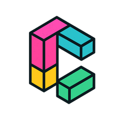
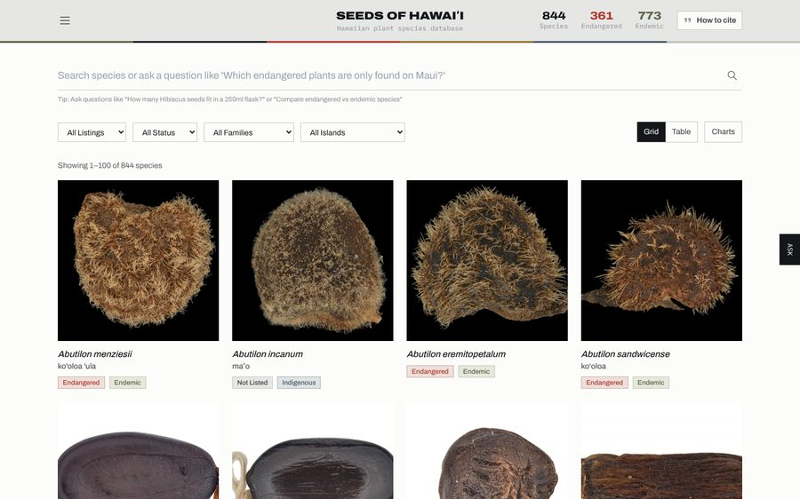
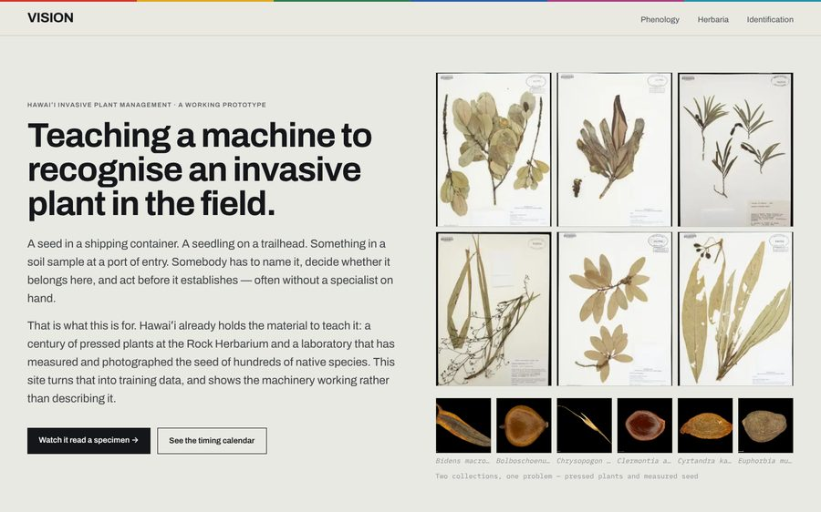
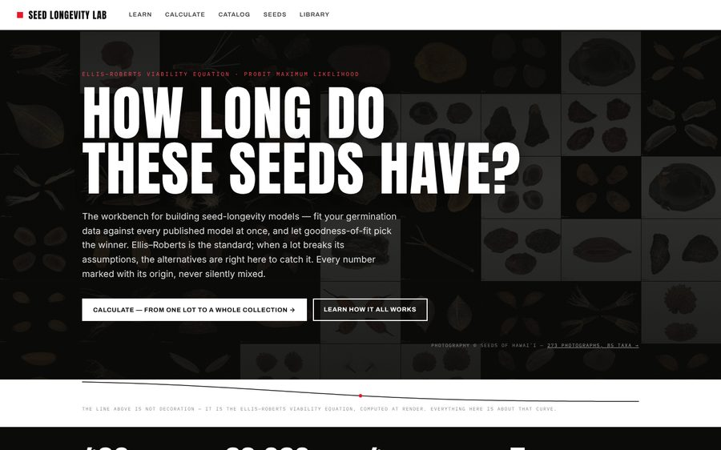
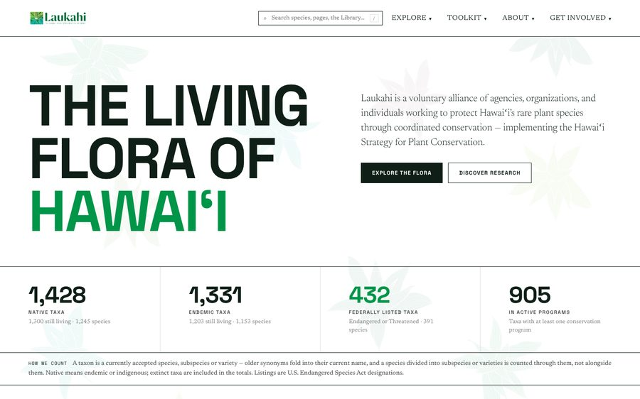
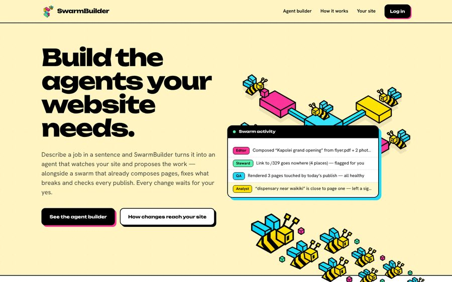
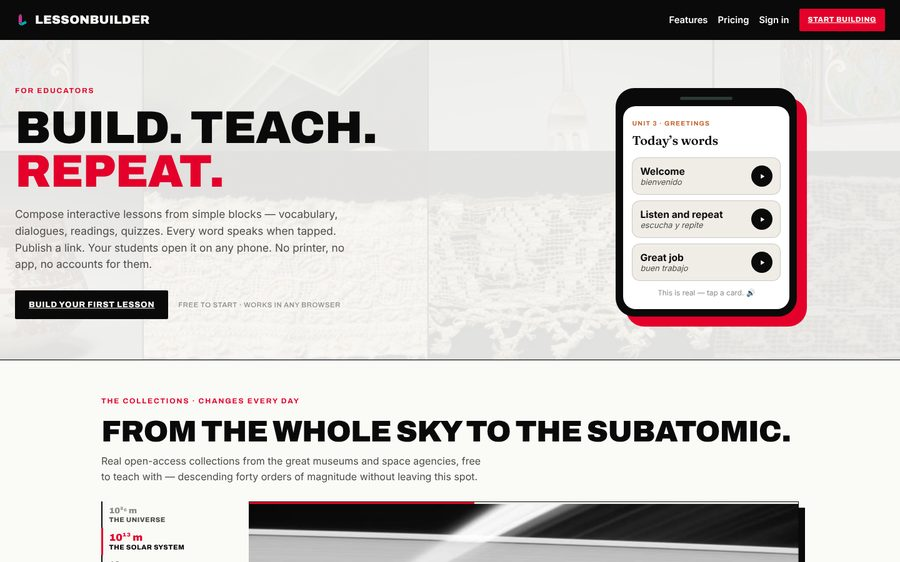
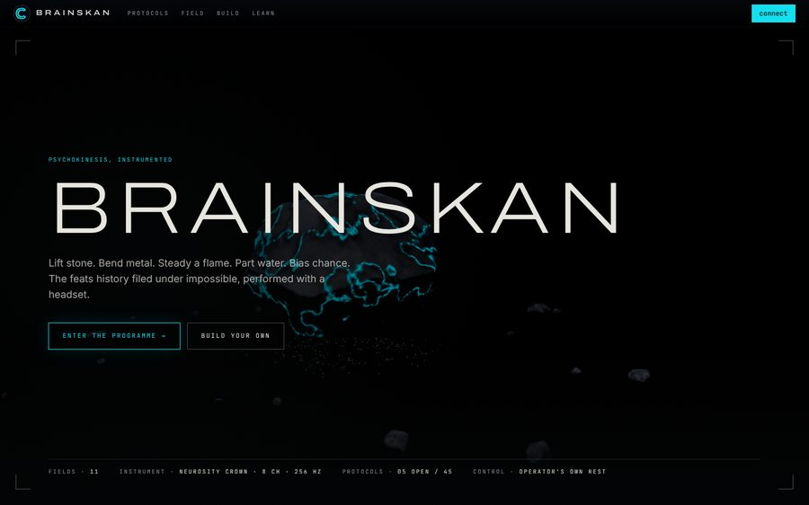

  

<h1 align="center">Clarifico</h1>

<strong>Data platforms, machine learning, and the tools that let institutions run them.</strong>

  <a href="https://clarifico.io">clarifico.io</a> · <a href="mailto:nicholas@clarifico.io">nicholas@clarifico.io</a> · Honolulu, Hawaiʻi · Minneapolis, MN

---

We build collections databases, multi-institution data networks and computer-vision models for museums, botanical gardens and conservation organizations — along with the front-end builders that let non-technical staff manage their own data. Formerly MoonBuzz Media, building since 2019.

## Featured work

<table>
  <tr>
    <td colspan="2">
      
       <strong><a href="https://seedsofhawaii.org">Seeds of Hawaiʻi</a></strong> 
      The seed database for Hawaiʻi's native flora, built for Lyon Arboretum at the University of Hawaiʻi at Mānoa: 844 species with measured seed traits, a synonym crosswalk across GBIF and regional checklists, federal and state conservation status, and plain-language search. Its framework is the foundation for a proposed national wild seed image database.
    </td>
  </tr>
  <tr>
    <td width="50%" valign="top">
      
       <strong><a href="https://vision.seedsofhawaii.org">VISION</a></strong> 
      Computer vision across 28,000+ herbarium specimens from 100+ herbaria: sheet parsing, label reading, phenology, and a seed key that says "unresolved" rather than guessing.
    </td>
    <td width="50%" valign="top">
      
       <strong><a href="https://longevity.seedsofhawaii.org">Seed Longevity Lab</a></strong> 
      A workbench for seed-longevity models: fit germination data against every published viability model at once, with goodness-of-fit to pick the winner.
    </td>
  </tr>
  <tr>
    <td width="50%" valign="top">
      
       <strong><a href="https://laukahi.org">Laukahi — Hawaiʻi Plant Conservation Network</a></strong> 
      A shared data commons for a statewide network: seed bank ledger, collection planner, GIS map studio and an AI assistant.
    </td>
    <td width="50%" valign="top">
      
       <strong><a href="https://swarmbuilder.io">SwarmBuilder</a></strong> 
      A multi-tenant website builder. Each organization runs its own users and pages; AI agents propose changes and people approve them.
    </td>
  </tr>
  <tr>
    <td width="50%" valign="top">
      
       <strong><a href="https://lesson-builder.com">LessonBuilder</a></strong> 
      Educators build interactive lessons and courses from 16 block types and their own materials, with versioned rollback.
    </td>
    <td width="50%" valign="top">
      
       <strong><a href="https://brainskan.io">BrainSkan</a></strong> 
      A browser-based brain–computer interface. Users train their own EEG decoders with live signal visualization.
    </td>
  </tr>
</table>

## What we build with

**Front end:** TypeScript · React · Next.js · Tailwind · D3 · MapLibre GL · CesiumJS
**Back end:** Node.js · Python · Rust · PostgreSQL · PostGIS · pgvector · Supabase
**Machine learning:** computer vision, embeddings and similarity search, synthetic training data, in-browser inference
**Biodiversity data:** Darwin Core · GBIF · iDigBio · iNaturalist · WoRMS · IUCN
**Infrastructure:** Vercel · Railway · Docker

## Open source

Most of our work runs in production for partner institutions and lives in private repositories. As we separate out reusable components, we publish them here under the MIT License.
